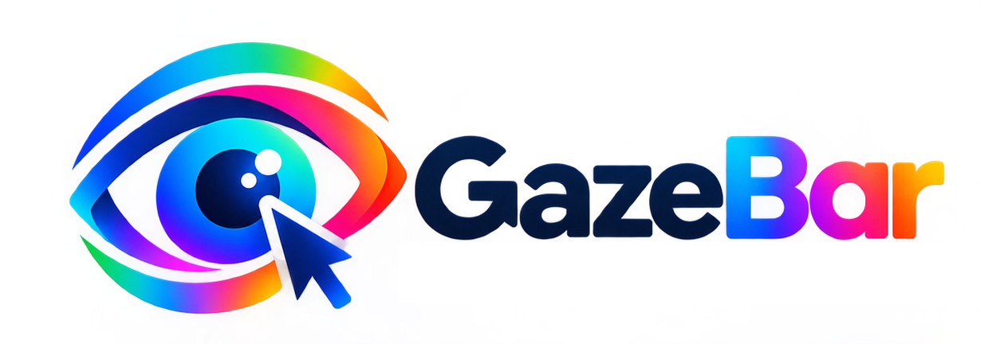

# GazeBar

*Version française : [README.fr.md](README.fr.md).*

**GazeBar lets you use a Windows computer with your eyes only**, with an eyetracker. A circle
follows your gaze; you stare at a place, then choose what to do there: click, double click,
right click, drag and drop, scroll, magnifier for small targets. It also has a gaze keyboard
with word prediction, a game mode, settings changed with the eyes, and an English and French
interface.

GazeBar is designed by and for a tetraplegic person with ALS (Charcot disease), who builds it
with his voice and his eyes only, with the help of the AI assistant Claude. Since November
2026 he uses GazeBar alone, every day, without TD Control: it is tested all the time, on a
Tobii Dynavox PCEye 5. If you are in the same situation, we hope it can help you too.

## Status

GazeBar is a young project (version 0.x): ready-to-run versions are on the
[Releases](https://github.com/Kopolitoo/GazeBar/releases) page, without an installer yet.
Planned next: sound feedback, automatic pause, colour themes, a first-run assistant,
text-to-speech.

## Requirements

- Windows 10 or 11, one screen.
- A Tobii eyetracker with its official driver (tested: PCEye 5; other models untested).
- The gaze software supplied with the eyetracker (TD Control) is **paused** while GazeBar runs.
- To compile: Visual Studio 2026 with the ".NET desktop development" workload and the .NET
  Framework 4.8 developer pack.

## Installation

1. Install the eyetracker driver from the manufacturer's website.
2. On the [Releases](https://github.com/Kopolitoo/GazeBar/releases) page, download
   `GazeBar-x.y.z.zip` (under "Assets") and unzip it, for example in `Documents\GazeBar`.
3. Start `GazeBar.exe`. The program is not signed, so Windows may show "Windows protected your
   PC": click "More info", then "Run anyway".
4. The eyetracker DLLs are not shipped with GazeBar: GazeBar looks for them in the eyetracker
   software. If the Diagnostic window says they are missing, see
   [Eyetracker files](docs/user-guide.md#eyetracker-files).

To compile it yourself instead: clone this repository, open `GazeBar.slnx` in Visual Studio,
press F5.

## Documentation

- [User guide](docs/user-guide.md): how to use GazeBar.
- [Architecture](docs/architecture.md): how the code is organised (for developers).
- [Manual tests](docs/manual-tests.md): what to check by hand on an eyetracker.
- [Contributing](CONTRIBUTING.md): rules for code, texts and pull requests.
- [Git guide](docs/GUIDE-GIT.md) (in French only): branches and pull requests in Visual Studio.

## Important notice

- **GazeBar is not a medical device.** It is not certified, comes without any warranty, and
  must not be the only way to call for help.
- One screen only. Windows started "as administrator" ignore GazeBar's clicks.
- GazeBar never saves gaze data and never writes typed text to its log.

## Licence

MIT: see [LICENSE.txt](LICENSE.txt). The word dictionaries are under CC BY-SA 4.0, and the
eyetracker DLLs belong to Tobii AB: see [THIRD-PARTY-NOTICES.md](THIRD-PARTY-NOTICES.md).

## Legal notice

This project is independent, open source software. It is not affiliated with, endorsed by or
supported by Tobii Dynavox. TD Control, Tobii and Dynavox are registered trademarks of Tobii AB.
